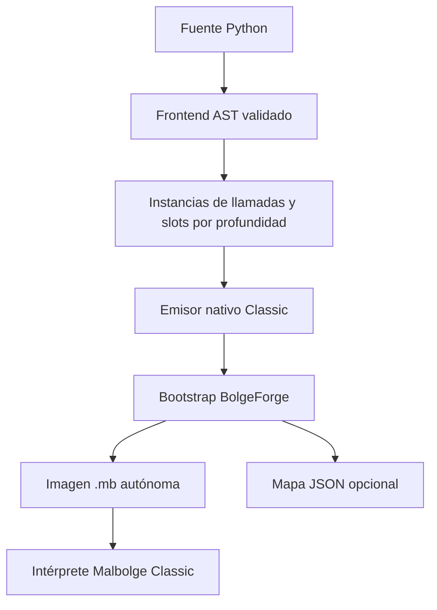

# Malbolge MB Database

**Python → Malbolge Classic. Funciones reales, retornos numéricos y ejecución autónoma.**

[](python/evidence/classic_compiler_v0/VERDICT.md)
[](MALBOLGE_CAPABILITIES.md)
[](ARCHITECTURE.md)

Malbolge MB Database es un laboratorio de compilación, ejecución e investigación reproducible sobre Malbolge. Su sistema principal actualmente es un **compilador de un subconjunto de Python a Malbolge Classic estricto**: convierte funciones y llamadas escritas en Python en programas `.mb` autónomos, con saltos físicos y direcciones de retorno almacenadas en la memoria ternaria de Malbolge.

No ejecuta el código Python para capturar su salida, no necesita una VM MBIR para ejecutar el resultado y no depende de un runtime Python durante la ejecución del `.mb`.

[Empezar](#empezar) · [Guía de uso](python/GUIA.md) · [Código del compilador](python/src/classic_compiler.py) · [Evidencia y veredicto](python/evidence/classic_compiler_v0/VERDICT.md)

## De Python a Malbolge

Ejemplo oficial — [`hola_tontos.py`](python/examples/hola_tontos.py):

```python
def saludar():
    print("Hola Tontos :P Jajajaja")

saludar()
```

El compilador genera una [imagen Classic de 39 932 bytes](python/evidence/classic_hola_tontos_v1/run01/hola_tontos/program.mb), que al ejecutarse imprime:

```text
Hola Tontos :P Jajajaja
```

La llamada a `saludar` y su retorno ocurren dentro de Malbolge. [Evidencia del saludo oficial](python/evidence/classic_hola_tontos_v1/VERDICT.md). El [mapa de ejecución](python/evidence/classic_hola_tontos_v1/run01/hola_tontos/map.json) y la [traza de instrucciones](python/evidence/classic_hola_tontos_v1/run01/hola_tontos/trace.json) permiten inspeccionar ambos saltos.

### Llamadas repetidas y anidadas

```python
def interior():
    print("¡Hola 🌎!", end=" ")

def exterior():
    print("Inicio")
    interior()
    print("Fin")

exterior()
exterior()
```

Salida observada al ejecutar [`anidada.py`](python/examples/anidada.py) compilado:

```text
Inicio
¡Hola 🌎! Fin
Inicio
¡Hola 🌎! Fin
```

## Empezar

Entorno verificado: Linux, Python 3.12 y GCC. El compilador utiliza [BolgeForge](https://github.com/DannyBaanks/BolgeForge) para sintetizar el bootstrap; la ejecución opcional utiliza Olmstead de [Malbolge-PureEpoch](https://github.com/DannyBaanks/Malbolge-PureEpoch). Por defecto espera ambos repositorios como directorios hermanos de Malbolge-MB-Database. También se puede indicar `BOLGEFORGE_ROOT` y `--runner`, respectivamente. Las revisiones y hashes de las dependencias verificadas están en [environment.txt](python/evidence/classic_compiler_v0/environment.txt).

Desde la raíz del repositorio, con esas dependencias disponibles:

```bash
out=$(mktemp -d)
python3 -B python/src/classic_compiler.py python/examples/hola_tontos.py \
  -o "$out/hola_tontos.mb" --map "$out/hola_tontos.json" --run
```

`--run` ejecuta la imagen recién compilada. Omítelo para generar únicamente el programa; `--map` también es opcional. Usa rutas nuevas: el compilador no sobrescribe archivos existentes.

Una imagen `.mb` ya compilada solo requiere un intérprete Malbolge Classic. Puedes empezar por las imágenes y los mapas incluidos en el [corpus reproducible](python/evidence/classic_compiler_v0/run01/).

## Cómo funciona



| Componente | Responsabilidad |
|---|---|
| [Frontend](python/src/classic_frontend.py) | Valida el AST, resuelve llamadas y aplica límites de expansión sin ejecutar la fuente. |
| [Backend](python/src/classic_backend.py) | Emite instrucciones Classic, slots de retorno numérico y bancos de punteros. |
| [CLI](python/src/classic_compiler.py) | Genera la imagen y el mapa; opcionalmente ejecuta el resultado. |
| [Pruebas](python/tests/test_classic_compiler.py) | Verifica equivalencia, determinismo, diagnósticos y protección de salidas. |

Malbolge modifica sus propias instrucciones al ejecutarlas. La estrategia actual especializa un cuerpo físico por instancia de llamada para no reutilizar instrucciones ya cifradas. Los retornos sí se realizan mediante saltos numéricos reales, con slots y journals separados por profundidad.

## Capacidades y límites de Classic v0

| Capacidad | Estado |
|---|---|
| Funciones sin argumentos y llamadas directas | Demostrado |
| Llamadas repetidas, anidadas y retorno temprano sin valor | Demostrado |
| `print` de cadenas literales, `sep`/`end`, UTF-8, `pass` y docstrings | Demostrado |
| Aislamiento de slots de retorno y ejecución de un solo uso por instancia | Demostrado en el corpus |
| Variables, argumentos, bucles, recursión y retornos con valor | No soportado |
| Despacho dinámico y reutilización física de cuerpos de función | No demostrado |
| Compilador alojado en Malbolge o Python completo | No demostrado |

Topes del frontend: 64 KiB de fuente UTF-8, 256 bytes de salida expandida, 32 instancias de llamada y profundidad 16. La disposición física de memoria puede imponer límites inferiores. Es un compilador escrito en Python cuyo **resultado** es Malbolge puro, no un compilador autoalojado.

## Evidencia reproducible

El corpus compara la salida exacta de CPython con Olmstead, clasesbolge, un trazador de instrucciones y REA. Las dos corridas conservan imágenes, mapas, trazas, resultados crudos y hashes SHA-256. REA verifica los destinos físicos de CALL/RET, el aislamiento de slots anidados y la ejecución de un solo uso.

- [Veredicto, alcance y controles](python/evidence/classic_compiler_v0/VERDICT.md)
- [Resultados de la primera corrida](python/evidence/classic_compiler_v0/run01/results.json) y [segunda corrida](python/evidence/classic_compiler_v0/run02/results.json)
- [Verificación REA](python/evidence/classic_compiler_v0/run01/rea.json) y [manifiesto SHA-256](python/evidence/classic_compiler_v0/hashes.sha256)
- [G5b P13: direcciones de retorno numéricas](vm_malbolge/evidence/g5b_flag_return_v13_numeric_slot/VERDICT.md) y [P14: llamada y retorno de saludar](vm_malbolge/evidence/g5b_flag_return_v14_saludar/VERDICT.md)

Para repetir las pruebas del compilador desde la raíz:

```bash
python3 -B python/tests/test_classic_compiler.py
```

## Laboratorio y ecosistema de investigación

El compilador Classic es la prioridad actual, pero el repositorio conserva la base de datos reproducible de programas Malbolge sustanciales, el middleware **MBIR** (*Malbolge Bytecode Intermediate Representation*) y las líneas de investigación de runtimes de lenguajes de alto nivel alojados sobre Malbolge. Sigue siendo el núcleo de almacenamiento y catálogo de la Suite de Datos y Runtimes v2.0 de ISyCo.

| Línea de trabajo | Documentación |
|---|---|
| Arquitectura, límites y estructura | [ARCHITECTURE.md](ARCHITECTURE.md) |
| Estado medido y registro de quine | [STATUS.md](STATUS.md) |
| Malbolge, MBIR y pruebas de capacidades | [MALBOLGE_CAPABILITIES.md](MALBOLGE_CAPABILITIES.md) |
| PureEpoch | [PUREEPOCH.md](PUREEPOCH.md) |
| Hoja de ruta y pistas de lenguaje | [ROADMAP.md](ROADMAP.md) |
| Comandos de reproducción | [REPRODUCING.md](REPRODUCING.md) |
| Base de datos y catálogo | [DATABASE.md](DATABASE.md) |
| Python alojado en Malbolge (línea independiente) | [python/README.md](python/README.md) |
| Quine registrada de 53 562 bytes | [quine/README.md](quine/README.md) |

[UNIECO](MALBOLGE_CAPABILITIES.md#unieco-eco-binario-con-eof-y-relocalizacion) demuestra un eco binario con EOF en una imagen Classic de 33 822 bytes. Su alcance y controles siguen documentados en capacidades.

### Investigación G5b previa

- [P2: cuatro llamadores secuenciales](vm_malbolge/evidence/g5b_flag_return_v2/VERDICT.md)
- [P3: orden cruzado de cuatro llamadores](vm_malbolge/evidence/g5b_flag_return_v3/VERDICT.md)
- [P4: las 24 permutaciones](vm_malbolge/evidence/g5b_flag_return_v4/VERDICT.md)
- [P5: cinco llamadores](vm_malbolge/evidence/g5b_flag_return_v5/VERDICT.md)
- [P5b: ventana REA tardía](vm_malbolge/evidence/g5b_flag_return_v5b_rea_window/VERDICT.md)

Las capacidades, estados y límites permanecen vinculados a sus evidencias específicas. Véase [CONTRIBUTING.md](CONTRIBUTING.md) para contribuir.
